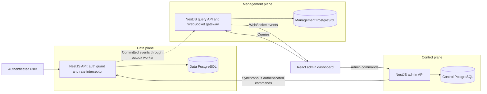
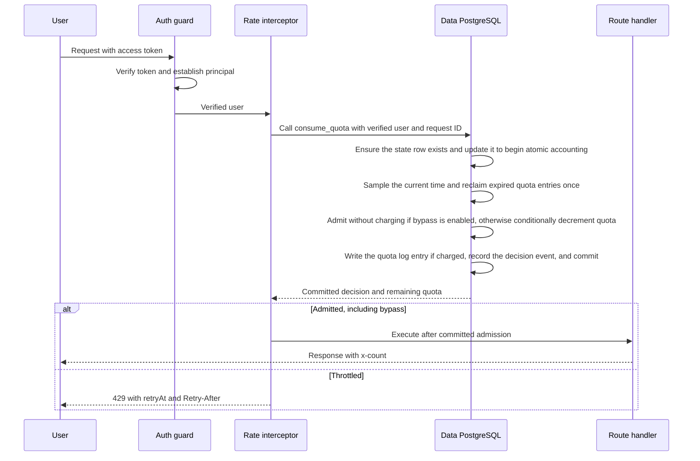

# Spikerz rate limiter: proposed solution

Status: implemented in this workspace. Updated to synchronous admin commands and notification-only WebSocket updates at the user's request. See [README.md](README.md) for startup, verification, and implementation details.

## Requirements and scope

This design builds on the original Spikerz full-stack assignment.

The assignment requests a NestJS rate limiting interceptor, a default allowance of 100 requests per user per hour, external storage, concurrency safety, an `x-count` remaining-quota header, HTTP 429 responses with retry information, and unit tests using a storage mock library. It also requests a TypeScript React/Angular admin UI, a live user table and detail view, reset/custom-limit/temporary-bypass/extra-quota controls, user search and status/activity filters, hour/day history, summary cards, and current-window rankings. Live updates must use `@nestjs/websockets` and the event names `rate:update` and `rate:limit_exceeded`.

The user's requirements take precedence over the assignment's hourly-reset and temporary-control wording: use an exact rolling one-hour request log; obtain identity from verified authentication; exclude bypassed requests from quota accounting while retaining them for observability; keep extra quota and bypass persistent until explicitly changed by an admin; use a database atomic conditional decrement for admission; separate data, control, and management planes, each with its own database; apply admin changes synchronously through the data-plane API, with no desired-policy table or control delivery worker.

## Recommended stack

- Three separately runnable NestJS applications in one npm-workspaces repository.
- React + TypeScript + Vite and MUI for the admin dashboard; choose current stable versions at implementation time and pin the lockfile.
- PostgreSQL for each plane, using `pg` and explicit SQL transactions for the small backend data model.
- `@nestjs/websockets` with the Socket.IO adapter, configured for WebSocket transport.
- Jest, `jest-mock-extended` for repository mocks, Supertest, and real PostgreSQL integration tests.
- Docker Compose: the three services, three PostgreSQL instances with separate volumes/credentials/networks, and the dashboard. Separate instances give clearer failure isolation than three databases on a shared server.

PostgreSQL is a deliberate simplicity choice: one database technology supports exact request logs, atomic conditional updates, command receipts, and event delivery. It trades some request latency and hot-user throughput for straightforward correctness. The assignment requires external storage but does not require Redis. A Redis sorted set plus an atomic Lua script is a reasonable later alternative if measured throughput requires it; it is not needed in the initial implementation.

## Plane boundaries



| Plane | Owns | Database contents |
|---|---|---|
| Data | Request admission and atomic application of admin commands | Runtime policies including persistent extra quota and bypass, quota balance, current quota epoch, exact quota-charged request log, applied-command receipts, event outbox |
| Control | Admin authorization, synchronous command delivery, audit trail | Command IDs, idempotency keys, outcomes, receipts, administrator identity/action records |
| Management | Dashboard queries, history, analytics, WebSocket delivery | Deduplicated events, user-state projections, request history, durable browser-update feed |

Services never access another plane's database. Internal APIs use service credentials and are not publicly exposed. User admission depends only on the data plane and its database: neither admin availability nor dashboard availability is on that path. A private command-application endpoint belongs to the data plane because only the data plane may mutate its runtime state.

Data owns the current configuration. Control validates and audits admin actions, then calls the data API during the same HTTP request. The dashboard shows the committed response immediately and the applied revision; management projections still update through the event outbox.

## Authentication and authorization

- A NestJS authentication guard verifies an access token's signature, allowed algorithm, issuer, audience, and expiration before the interceptor executes. Use the verified issuer/subject pair as the stable identity, or map it to an internal ID.
- The interceptor reads only the verified principal on the request. Never trust `X-User-ID`, an unverified JWT decode, a query parameter, or a body field for the requesting user's identity.
- Missing or invalid authentication returns 401 before quota accounting. Valid users share one per-user bucket across protected demo routes and all data-plane replicas.
- Admin HTTP APIs and WebSocket handshakes require a verified admin role. Validate socket credentials at connection time, authorize subscriptions, and disconnect when credentials expire. Do not put bearer tokens in URLs.
- Demo identities come from a local development token issuer with seeded user/admin accounts. The signing key is available only to that issuer; production uses an external trusted issuer. Keep demo issuance explicitly development-only.
- Configure the demo login password through `DEMO_PASSWORD` in an ignored `.env` file or the environment. There is no built-in password; the committed `.env.example` leaves it empty, and the login form starts blank. Demo traffic obtains user tokens through the authenticated admin session without resending the password.

## Exact quota semantics

Let `t` be data-database time, `L` the applied base limit (default 100), and `E` the persistent extra quota (default 0).

```text
used(t)      = quota-charged requests in the current reset epoch with t - 1h < admitted_at <= t
capacity    = L + E
remaining(t)= max(0, capacity - used(t))
admit       = bypass_enabled OR used(t) < capacity
charge_quota= admitted AND NOT bypass_enabled
```

Maintain a stored `quota_balance` for the atomic decrement. Immediately after reclaiming expired entries, its invariant is `quota_balance = capacity - used(t)`; the balance may be stale between operations because expiry is reclaimed lazily. It can be negative after an admin reduces capacity below existing usage. Preserve that debt internally so later expirations restore the correct allowance; clamp only the externally reported remaining quota.

- Every admitted non-bypassed request adds an individual quota-log entry. Bypassed requests and requests denied with 429 do not consume quota; all decisions are still recorded as observability events with `bypassed` and `quotaCharged` flags.
- For non-bypassed requests, charge admission before running the handler. A later business error or disconnect does not refund quota. This keeps concurrent decisions deterministic.
- While bypass is enabled, admit requests without decrementing quota or adding quota-log entries. Existing quota-charged requests continue aging out normally; enabling bypass does not clear them. Disabling bypass enforces against only the non-bypassed admissions still inside the sliding hour, with no retroactive charge for bypassed traffic. For example, with 90 charged requests and 1,000 bypassed requests, disabling bypass leaves 10 requests available at capacity 100, assuming none of the 90 have expired. Clamp remaining quota at zero if an admin has reduced capacity below charged usage.
- The lower window boundary is exclusive: a request admitted at 10:00:00 no longer counts at 11:00:00. There is no hourly reset cron job.
- A custom base limit is a positive integer. Reducing it below current usage immediately prevents new admissions unless bypass is active; it never rewrites history.
- Manual reset advances a per-user quota epoch. It preserves the base limit, persistent extra quota, and bypass setting. Earlier log entries remain historical but stop consuming quota. An epoch avoids timestamp ties between a reset and a request.
- Extra quota is a persistent nonnegative supplement to rolling-hour capacity. For example, base 100 plus extra 50 allows 150 requests in every rolling hour until an admin changes the extra quota. It is not a one-time credit balance. Set its absolute value to change it, or set it to zero to remove it; reducing capacity below current usage immediately enforces against that usage unless bypass is enabled.
- Bypass is a persistent boolean. Enabling it suspends enforcement and quota charging until an admin disables it. Extra quota and bypass have no TTL, survive restarts and manual usage resets, and change only through explicit, audited admin commands. A request racing a bypass toggle uses the setting established by their per-user transaction order.

### Headers, retry information, and table labels

- `x-count` is the remaining quota at decision time, after charging a non-bypassed admission. Bypassed requests do not decrement it; it still reflects the underlying quota rather than an unlimited sentinel value. Include it on successful responses and expose it through CORS. Concurrent responses can arrive out of order.
- A 429 response includes `x-count: 0`, a meaningful error, `retryAt` as a UTC timestamp, and `Retry-After` as rounded-up seconds.
- Compute `retryAt` as the earliest future time when `used(t) < capacity`, assuming no new traffic or admin changes. With `N` current quota-charged requests and capacity `C`, a throttled user needs `N - C + 1` requests to expire; use that request's admission time plus one hour. Using only the oldest request's expiry is wrong after a capacity reduction. Bypassed traffic is excluded from this calculation.
- UI `Reset Time` becomes **Next quota change**, with explanatory text; `nextAllowedAt` is also shown when throttled. `Last reset` means last manual reset, nullable when none occurred. A rolling window has no periodic full reset.
- Resolve the assignment's overlapping 90% thresholds: OK is below 90%; Warning is at least 90% and below 100%; Exceeded is at least 100%. Bypass is a separate badge, so an over-quota bypassed user can still be shown as Exceeded with enforcement paused.
- Example: 60 requests at 10:00 and 40 at 10:30 fill the quota. At 11:00 only those first 60 leave the log; the 40 from 10:30 still count.

## Race-safe admission with an atomic conditional decrement

Use an atomic `UPDATE ... WHERE quota_balance > 0 RETURNING ...` for admission. There is no application mutex, explicit `SELECT FOR UPDATE`, or optimistic read/retry loop. PostgreSQL still takes row locks internally for writes; all accounting changes for a user therefore serialize through updates to that user's state row. This is database-managed synchronization, not a lock-free algorithm.

Expose one database function, `consume_quota(user_id, request_id)`, to the interceptor. The function performs expiry accounting, conditional decrement, request logging, and outbox insertion in one transaction, with one database round trip. A single application call contains several sequential SQL statements inside the database; a decrement alone cannot maintain an exact sliding window.



Database-function outline, using READ COMMITTED and sequential statements in a VOLATILE PostgreSQL function:

1. `INSERT ... ON CONFLICT DO NOTHING` ensures the user row exists safely on concurrent first requests, initializing `quota_balance` to the applied capacity.
2. Start accounting with `UPDATE user_state SET event_version = event_version + 1 WHERE user_id = ... RETURNING ...`. This reserves the event version and establishes PostgreSQL's write ordering before touching the quota log. Its implicit row lock lasts through the transaction. All admission, admin-application, and expiry-refresh routines use this same initial state update.
3. After that update completes, sample `clock_timestamp()` once. In subsequent statements, delete current-epoch quota-log entries with `admitted_at <= t - interval '1 hour'`, count the deleted entries through `DELETE ... RETURNING`, and add that count to `quota_balance`. Each entry returns exactly one quota unit. Read Committed gives these subsequent statements a fresh view after any wait. Do not move the log read into a CTE or subquery evaluated before the initial update finishes.
4. Read the applied policy from the state returned by the initial update. If bypass is enabled, admit without decrementing or adding a quota-log entry. Otherwise run the conditional decrement below. A returned row means admission; no returned row means quota denial because state existence and bypass have already been resolved.
5. For a charged admission, insert the request ID, current epoch, and sampled admission time into `quota_log` in the same transaction. For every decision, insert the event using the reserved version, including `bypassed` and `quotaCharged`. Recompute `next_change_at` from the oldest remaining current-epoch quota entry.
6. Return the decision, `max(0, quota_balance)`, and retry metadata. Commit both admitted and denied decisions. Throw the NestJS 429 exception only after the database call commits so denied-request telemetry is not rolled back.
7. Run the business handler only after a committed admission. Never perform business logic, internal HTTP delivery, or WebSocket work inside the accounting transaction. If any accounting statement fails, the balance change, reclaimed entries, new log entry, and event all roll back together.

The admission statement, after expiry reclamation and the bypass check:

```sql
UPDATE user_state
SET quota_balance = quota_balance - 1
WHERE user_id = $1
  AND bypass_enabled = false
  AND quota_balance > 0
RETURNING quota_balance;
```

All writers follow this protocol, so simultaneous requests and admin actions have a definite order for each user. At capacity 100 with bypass disabled, 200 concurrent requests to a fresh user admit exactly 100. Different users update independent state rows. Avoid multi-user transactions, bound statement waits, and return 503 on database unavailability or uncertain admission rather than allowing an unrecorded request. Do not automatically retry an uncertain commit and execute the handler twice. Race safety assumes a single authoritative writable database with committed state preserved across recovery; asynchronous replica promotion with data loss is outside the take-home guarantee.

Useful data-plane tables:

```text
user_state(user_id PK, base_limit, extra_quota, bypass_enabled, quota_balance, quota_epoch,
           last_manual_reset_at, applied_control_revision, event_version, next_change_at)
quota_log(request_id PK, user_id, quota_epoch, admitted_at)
applied_commands(command_id PK, user_id, control_revision, result)
event_outbox(event_id PK, user_id, user_version, payload, delivered_at)
```

Index the quota log by `(user_id, quota_epoch, admitted_at)`. Current-epoch log entries are outstanding quota charges: delete expired entries only through the atomic reclamation routine that refunds their quota. A generic cleanup job must not remove them without updating the balance. Old-epoch entries may be deleted without a refund after a reset. Persistent policy fields have no expiry cleanup. Separate unique request IDs preserve simultaneous requests with identical timestamps.

For a base-limit or extra-quota change, reclaim due entries and add `new_capacity - old_capacity` to `quota_balance` in the same transaction as the policy update. Preserve a negative result instead of losing the amount by which usage exceeds capacity. A manual reset advances the epoch and sets the balance to current capacity; old-epoch expirations must never refund into that new balance. A bypass toggle leaves the balance unchanged apart from normal expiry reclamation. These rules preserve the balance/log invariant during concurrent admin changes.

## Synchronous admin commands

1. The control API authorizes and validates the action, then reserves an audit record and stable command ID for the required idempotency key. A conflicting action/target/actor under the same key returns 409. Audit reservation commits before outbound HTTP; there is no cross-database transaction.
2. Control calls the authenticated data-plane `POST /internal/commands` endpoint directly with `{ commandId, userId, action }` and waits for its result. There is no desired-policy table, delivery worker, command queue, or automatic retry.
3. Data applies the action through the same initial state-update and quota-reclamation protocol used by admission. After the initial update, it checks command deduplication. A duplicate rolls back that attempt's reserved version/reclamation and returns the saved receipt. Matching legacy receipts ignore the former caller-supplied revision field.
4. For a new action, the data transaction assigns the next per-user applied revision, adjusts policy/balance or reset epoch, and saves a receipt plus state-change event atomically. Concurrent actions follow database application order; the last applied edit to a field wins. An unrelated failed/unconfirmed action does not block new commands.
5. Control saves the acknowledged receipt in its audit record and returns 200 with `{ commandId, revision, state }`. The UI uses that committed state immediately and prevents an older management projection from overwriting it in the inspector.
6. Network failures, timeouts, or uncertain acknowledgment return an error (503 for an unknown outcome) and leave an `unconfirmed` audit record. This record is never delivered in the background. The administrator can explicitly retry the same key/body; data-plane receipts prevent duplicate effects, including resets. A definite 4xx rejection is recorded as `failed`.

The control schema contains only command audit/idempotency records. Migration removes the former desired-policy table and queue fields, preserving command IDs and existing audit history. Legacy pending actions become unconfirmed and require explicit retries. Deploy the data/control API changes together.

Public control routes:

| Route | Action |
|---|---|
| `PUT /admin/users/:id/limit` | Set base limit and wait for application |
| `POST /admin/users/:id/reset` | Advance quota epoch and wait for application |
| `PUT /admin/users/:id/bypass` | Set persistent `enabled: true/false` |
| `PUT /admin/users/:id/extra-quota` | Set persistent extra quota; zero removes it |
| `GET /admin/commands/:id` | Inspect applied/failed/unconfirmed audit record |
| `GET /admin/users/:id/commands` | Recent user command audit records |

The authenticated admin selects a target `:id`; this is separate from how the data plane establishes the requesting user's identity. There is no desired configuration or expected desired revision in the API.

## Durable observability and WebSockets

- The data transaction writes a quota decision and its event together. A polling outbox worker delivers committed events to management over an authenticated internal batch endpoint. Start with one dispatcher and preserve per-user order; no message broker is required.
- Management inserts each event using a unique `event_id`, updates the user projection and history, and writes a durable browser-update record in one transaction before acknowledgment. Duplicate deliveries do not duplicate analytics. Per-user versions detect stale or missing updates; gaps are retried rather than silently accepted.
- A management worker broadcasts committed change notifications through a NestJS gateway: `rate:update` for allowed decisions and state changes, and `rate:limit_exceeded` for denials. Both contain only `{ userId }`. The browser fetches quota state, request history, and analytics over HTTP; no full event payload or browser feed position is sent. Never include access tokens.
- The internal browser feed remains durable across management-worker restarts, with positions allocated in commit order. It is no longer a browser replay API. Duplicate notifications are harmless because the browser refetches current data; durable history and event deduplication remain in management storage.
- Avoid the initial subscription race: acknowledge `subscribe` only after joining the admin room, then fetch current HTTP data. Further notifications schedule another GET refresh, including if a fetch is already running. On reconnect, subscribe and fetch again, without a replay cursor or buffered event merge. Group dashboard refreshes in 200 ms windows and selected-user detail refreshes in 250 ms windows rather than fetching for every event. Refresh both views every 30 seconds as a fallback.
- A small data-plane worker checks indexed `next_change_at` values approximately once a second and calls `refresh_quota(user_id)` for due users. This shares the initial state-update and reclamation logic, emits a state event, and never decrements quota or creates a charged request. Admission also reclaims all entries due at decision time, so a delayed worker cannot cause a false quota denial. This keeps an idle dashboard current. Schedule the next request expiry even when the current remaining count is zero. Extra quota and bypass require no expiration jobs.
- Aim for below one second of dashboard lag under normal load; measure this as a target, not a guarantee. Show `asOf`, socket connectivity, command outcomes, outbox backlog, and stale-data status. A gateway heartbeat communicates ingestion/expiry-worker health so a connected but stale dashboard is detectable.
- Management outages leave data admission running and events queued durably, within storage capacity. Control outages leave the last applied rules, extra quota, and bypass setting active. Data database outages return 503. Bound retries and monitor outbox capacity so prolonged outages are visible.

Management queries:

```text
GET /users?search=&status=&lastActiveSince=&cursor=
GET /users/:id
GET /users/:id/requests?range=hour|day&cursor=
GET /analytics/summary
GET /analytics/top-users
```

The UI contains a live searchable/filterable user table; a user detail drawer with current stats, recent decisions, hour/day history, manual reset time; admin action dialogs that wait for an applied response or show an error; and summary cards plus top-user rankings. WebSocket notifications trigger GET requests for table rows, active filters, cards, rankings, and the selected user's details. HTTP responses supply the data rendered by those views.

Define analytics explicitly: total users means distinct authenticated users observed by this limiter, including inactive users retained in the management registry; near-limit percentage means observed users with charged quota usage >=90% and <100%; 429 count today uses UTC day boundaries, labeled in the UI; top users ranks all admitted requests in the preceding hour, including bypassed traffic, with charged quota usage shown separately. Show regular admissions, bypassed admissions, and denials separately in historical charts. Remaining-quota values and status filters use only quota-charged requests in the current reset epoch. Preserve at least 25 hours of management request history to cover a full day; retain unsent source events until acknowledged. Manual reset changes quota accounting, not historical activity totals.

## Verification

Unit tests use a mock library for storage interfaces as requested by the assignment. Real-database tests establish atomic-update and transaction behavior; a mock cannot prove concurrency safety.

| Test | Expected result |
|---|---|
| First, 100th, and 101st request | Remaining 99, remaining 0, then 429 |
| 200 parallel calls through two API replicas | Exactly 100 admissions and 100 denials |
| Parallel first request for an unseen user | One state row and no lost request records |
| Different users | Independent quota accounting |
| Window boundary and cross-hour bursts | Individual entries expire exactly one hour after admission |
| Identical admission timestamps | Each request remains separately counted |
| Concurrent requests and expiry worker reclaim the same due entries | Each charge returns quota exactly once; balance matches capacity minus live charges |
| Expiry worker is delayed or unavailable | Admission reclaims due charges itself and admits when quota is available |
| Failure between decrement, quota-log insertion, and outbox insertion | Entire transaction rolls back, including any reclaimed quota |
| 90 charged requests, 1,000 bypassed requests, then admin disables bypass | Bypassed traffic remains visible; 10 requests remain at capacity 100 if the 90 have not expired |
| Bypass spans expiration of earlier charged requests | Earlier charges age out normally; bypass does not freeze or reset the rolling log |
| Successful bypassed request and x-count header | No quota-log entry or decrement; remaining reflects only existing charged usage |
| Limit lowered below usage | Retry time waits for enough expirations, not only the oldest entry |
| Extra quota and bypass across an hour boundary, restart, and manual reset | Settings persist until explicitly changed by an admin |
| Extra quota reduced or removed below current usage | Existing requests remain counted; enforcement uses the new capacity |
| Capacity reduced from 100 to 50 with 90 charged requests | Internal balance becomes -40; 41 charges must expire before another admission |
| Reset races expiry reclamation | New balance equals capacity; old-epoch charges never refund into it |
| Requests racing reset/base-limit/extra-quota/bypass commands | Outcomes match one valid per-user transaction order |
| Lost admin acknowledgment and duplicate delivery | One effect and one audit command, with replayed result |
| Invalid, expired, wrong-audience token or spoofed user header | No impersonation and no unauthenticated quota admission |
| Duplicate/reordered events, crash after persistence before broadcast | Deduplicated history and recoverable change notifications |
| No traffic while quota entries expire | Dashboard recovers without another user request |
| Management outage, then recovery | Admissions use applied rules; pending events catch up |
| Data-plane outage during admin edit | Admin call returns an error; an explicit same-key retry applies once after recovery |
| Control outage | Admissions keep using applied rules; no configuration work is queued |
| Data database unavailable or admission uncertain | 503 and no business-handler execution |
| UI reconnect during a concurrent update | Subscribe, then fetch current HTTP data; subsequent notifications trigger another refresh |

Use an injected clock for deterministic pure quota-math tests. Production admission time comes from PostgreSQL. For integration boundary tests, seed precise timestamps and matching balances rather than waiting an hour. Exercise an update wait across an expiry boundary to verify that time is sampled after the initial state update completes.

## Implementation order and completion criteria

1. Scaffold the workspace, Compose services, schemas/migrations, shared API types, verified authentication, and seed identities.
2. Build the atomic quota-consumption function, sliding-log reclamation and balance invariants, interceptor, headers/errors, and multi-replica concurrency tests.
3. Add synchronous idempotent admin commands, data-assigned applied revisions, audit, and command-versus-request race tests.
4. Add transactional outboxes, management projections/history, expiry refresh, and authenticated WebSocket synchronization/recovery.
5. Build the dashboard, filters, detail history, admin action state, and analytics.
6. Run the complete checks, document architecture/semantics/failure behavior and demo steps, then package the repository or zip with all dependencies/scripts declared.

Keep shared code limited to authentication utilities, types/schemas, and pure quota calculations; do not share database clients or reach across plane repositories. Suggested layout: `apps/data-api`, `apps/control-api`, `apps/management-api`, `apps/admin-web`, `packages/contracts`, `packages/quota-math`, and `infra`.

Completion requires a one-command local startup, a clear README, deterministic seeded users/admin, a demo request endpoint, mocked-storage unit tests, passing real-PostgreSQL concurrency/integration tests, and a live dashboard demonstrating throttling, bypass accounting, admin updates, expiration, and reconnect recovery.

## Technical references

- [NestJS request lifecycle](https://docs.nestjs.com/faq/request-lifecycle): authentication guards run before interceptors.
- [NestJS gateways](https://docs.nestjs.com/websockets/gateways): gateway support and Socket.IO adapter.
- [PostgreSQL row locking](https://www.postgresql.org/docs/current/explicit-locking.html): row-level locks serialize writers/lockers until transaction end.
- [PostgreSQL transaction isolation](https://www.postgresql.org/docs/current/transaction-iso.html): READ COMMITTED statement snapshots.
- [PostgreSQL date/time functions](https://www.postgresql.org/docs/current/functions-datetime.html): wall-clock time versus transaction-start timestamps.
- [PostgreSQL function volatility](https://www.postgresql.org/docs/current/xfunc-volatility.html): VOLATILE functions may modify data and obtain a fresh snapshot for each internal query.
